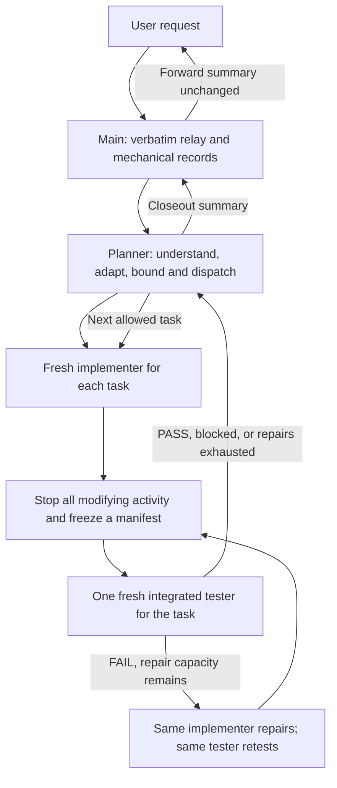

# Relay Workflow

[](https://github.com/chenzhenzhong12138/relay-workflow/actions/workflows/validate.yml)
[](LICENSE)

[简体中文](README.zh-CN.md) · [Usage](docs/usage.md) · [Examples](examples/README.md) · [Compatibility](docs/compatibility.md)

**An explicitly invoked agent workflow for bounded work, independent acceptance, and recoverable handoffs.**

Relay Workflow gives the main conversation a narrow job: forward the user's words unchanged and keep mechanical records. A planner interprets the task, a fresh implementer produces each candidate, and one fresh independent tester checks the frozen result. Failed acceptance returns to the same implementer and tester, with at most three actual repair rounds.

Use it for a small software change, a document, a data analysis, a design deliverable, or a hardware task with clearly available prerequisites. The planner adapts acceptance to the current working directory; you do not rewrite the global Skill for every project.

## Quick start

Requires Python 3.11+ to install, and a client with the required native agent tools. The installer itself uses only the Python standard library and does not access the network.

```sh
git clone https://github.com/chenzhenzhong12138/relay-workflow.git
cd relay-workflow
python scripts/install.py --client both --scope user --dry-run
python scripts/install.py --client both --scope user
```

Reopen or restart your client if the entry is not visible. Open the directory where you want the work performed, then explicitly invoke the Skill:

**Codex**

```text
$relay-workflow execute: Add --output to the existing CSV summary command. Keep stdout as the default. Cover file output and invalid paths, and update the command's usage documentation.
```

**OpenCode 2.0.28**

```text
/relay-workflow execute: Add --output to the existing CSV summary command. Keep stdout as the default. Cover file output and invalid paths, and update the command's usage documentation.
```

Chinese `执行：` and `恢复：` forms are supported. Questions, mentions, quoted examples, installation, and rule discussions do **not** start the workflow. See [complete invocation and recovery forms](docs/usage.md).

To install for just one project, use an existing directory:

```sh
python scripts/install.py --client codex --scope project --project-root "C:/work/my-project" --dry-run
python scripts/install.py --client codex --scope project --project-root "C:/work/my-project"
```

`--client` accepts `codex`, `opencode`, or `both`; `--scope` accepts `user` or `project`. Defaults are `both` and `user`. Add `--json` for machine-readable installer output.

The installer preflights every destination before writing. Identical files are left unchanged; differing existing content stops installation. It deletes no files and does not edit existing `AGENTS.md`, model settings, permissions, or global configuration files. A user installation is available across working directories; a project installation is local to that project.

## How work moves



The main does not interpret technical requirements, decompose work, diagnose, implement, test, monitor progress, or write a technical summary. Children do not recursively delegate. Detailed plans and evidence stay in run files; the main receives compact routing metadata and real runtime IDs.

One tester covers `functional`, `engineering`, and `system` checklists. It tests a manifest-bound candidate, never repairs it, and cannot combine PASS results from different candidates without explicitly rebinding unaffected evidence. Missing required evidence remains blocked or not run.

## Deliberate limits

| Default | Bound |
| --- | --- |
| Scope per requested round | One main acceptance goal; at most four work packages |
| Planning depth | Request → package; at most five semantic implementation steps per package |
| Batch size | One task; each task gets a fresh implementer and tester |
| Role dispatch or continuation | At most 30 actual tool calls; planner 15 minutes, implementer/tester 45 minutes |
| Failed acceptance | Initial round 0, then at most three actual repair rounds |
| Problem supplements | At most two, only with qualifying new information; counted separately from repairs |
| No progress | Stop after two consecutive steps without progress |
| Larger requests | Accept a dependency-closed slice; record at most three follow-on topics without automatically doing them |

These are agent operating contracts, not automatic platform cutoffs. External prerequisites, permission gaps, and API or quota errors return blocked without automatic retry. The full [limits](skills/relay-workflow/references/limits.md) define search, command retry, timeout, exception, and recovery rules. No bulk file or directory deletion is allowed, and existing permissions still apply.

## Adapt to the task

The planner freezes a run-specific `profile.md`: allowed scope, available inputs and tools, acceptance criteria, evidence, budgets, and stop conditions. The same three dimensions mean correctness, deliverable quality, and use in the intended context across domains.

| Domain | Examples of relevant acceptance |
| --- | --- |
| Software | Behavior and edge cases; relevant checks; actual interfaces |
| Documents | Accurate coverage; rendered layout; opening/export in the intended tool |
| Data or research | Correct results; provenance and reproducibility; downstream interpretation |
| Design | Intended interactions; consistency and accessibility; handoff or device use |
| Hardware | Behavior; applicable timing/resources; required real-device evidence |

Checks are proportional to the task. Required hardware or live-system gates cannot be replaced by offline results. See [adaptation](skills/relay-workflow/references/adaptation.md) and [four complete example requests](examples/README.md).

## Compatibility and validation

The package includes a Codex Skill and OpenCode 2.0.28 native command/agent adapters. Runtime calls must match the host's actual exposed schema. Run files support recovery across clients with explicit old-to-new ID mapping and preserved counters; runtime sessions themselves are not portable.

Current automated validation covers the distributable package, configuration, adapters, links, and installer behavior. **The complete live multi-client role chain has not yet been exercised.** Client discovery and real orchestration require separate validation. See [compatibility and validation scope](docs/compatibility.md) and [runtime adapters](skills/relay-workflow/references/runtimes.md).

```sh
python -m pip install -r requirements-dev.txt
python scripts/validate.py
python -m unittest discover -s tests -v
```

## Repository guide

```text
skills/relay-workflow/   Skill, role contracts, runtime references and run templates
adapters/opencode/      Native OpenCode agents and command
scripts/                Installer and offline validation
tests/                  Installer/package tests
docs/                   Usage, compatibility and references
examples/               Illustrative requests and handoffs
```

Read the [Skill entry](skills/relay-workflow/SKILL.md), [shared contract](skills/relay-workflow/references/contract.md), and [evidence rules](skills/relay-workflow/references/evidence.md) for the full protocol. Contributions are welcome through the [contribution guide](CONTRIBUTING.md). Released under the [MIT License](LICENSE).
