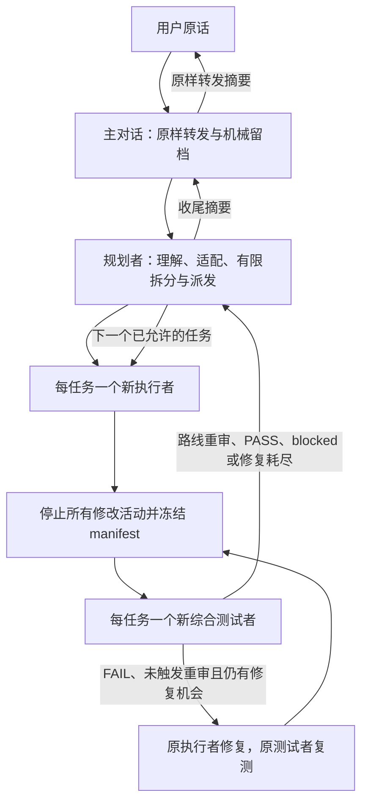

# Relay Workflow

[](https://github.com/chenzhenzhong12138/relay-workflow/actions/workflows/validate.yml)
[](LICENSE)

[English](README.md) · [使用指南](docs/usage.md) · [完整示例](examples/README.md) · [兼容性](docs/compatibility.md)

**显式启动、有界执行、独立验收、可从文件恢复的多智能体工作流。**

主对话只原样转发用户原话、机械记录路径和真实运行 ID。规划者理解需求并确定本轮范围；每个任务由一个新执行者完成，停止修改并冻结候选后，再交给一个新的独立综合测试者。验收失败续接同一执行者和测试者，最多进行三轮实际修复，最后由原规划者更新记录或收尾，主对话原样转发用户摘要。

适用于软件、文档、数据研究、设计和硬件等任务。规划者按当前任务生成验收配置，不需要每换一个工作目录就修改全局 Skill。

## 快速开始

安装需要 Python 3.11+。安装器仅使用 Python 标准库，不联网；执行工作流还需要客户端提供相应的原生多智能体工具。

```sh
git clone https://github.com/chenzhenzhong12138/relay-workflow.git
cd relay-workflow
python scripts/install.py --client both --scope user --dry-run
python scripts/install.py --client both --scope user
```

如果入口尚未显示，重新打开或重启客户端。随后打开**实际要工作的目录**，在对话中输入：

Codex：

```text
$relay-workflow 执行：为现有 CSV 汇总命令增加 --output 参数，默认仍输出到标准输出。覆盖文件输出和无效路径，更新命令使用文档。
```

OpenCode 2.0.28：

```text
/relay-workflow 执行：为现有 CSV 汇总命令增加 --output 参数，默认仍输出到标准输出。覆盖文件输出和无效路径，更新命令使用文档。
```

也支持 `execute:` 英文形式。仅提及名称、引用调用示例、普通问答、安装或讨论修改规则，都不会启动角色链。

安装选项：

| 选项 | 含义 |
| --- | --- |
| `--client both` | 安装到两个客户端；也可选 `codex` 或 `opencode` |
| `--scope user` | 当前用户可在不同工作目录显式使用；默认范围 |
| `--scope project --project-root "C:/work/my-project"` | 仅安装到一个已存在的项目目录 |
| `--dry-run` | 检查冲突并显示目标路径，不写入 |
| `--json` | 以 JSON 返回安装结果 |

默认组合为 `both`、`user`。只为一个项目安装的例子：

```sh
python scripts/install.py --client both --scope project --project-root "C:/work/my-project" --dry-run
python scripts/install.py --client both --scope project --project-root "C:/work/my-project"
```

安装器先检查所有目标：同内容重装不改文件，已有不同内容则在写入前停止；不删除文件，不修改现有 `AGENTS.md`、模型、权限或全局配置文件。它将同一份 Skill 包复制到两个客户端各自的原生发现位置，另为 OpenCode 安装薄命令和角色适配文件。

## 固定角色链



主对话不理解技术需求、不拆分、不设计、不诊断、不实现、不测试、不监控进度，也不撰写技术总结。子角色不递归派生。详细计划和证据保存在运行文件中，主对话只接收精简路由信息。

`functional`、`engineering`、`system` 是**一个综合测试者**的三份检查清单，分别检查请求符合性、交付质量以及实际使用或集成。执行者必须停止修改和相关生产活动后冻结唯一候选；测试结果绑定该 manifest。修复后重新冻结，不能拼接不同候选的 PASS。缺少必要工具、数据、设备、权限或真实证据时，如实返回 blocked / not_run。

关键前提被证据推翻，或连续两轮没有影响判断的新证据时，先回原规划重审，再决定是否续修。可执行且获授权的事实检查须交实际结果；收尾须明确当前可用候选及已证范围，或直说暂无合格候选，并给出下一步推荐。详见[路线重审与浅显汇报](skills/relay-workflow/references/decision-reporting.md)和[收敛情境示例](examples/README.md#5-route-reassessment-and-candidate-convergence)。

公共字段、cycle去重与异常收口统一在[控制合同](skills/relay-workflow/references/control-contract.md)：冻结与验收只结算一次，修复复测使用新cycle；真实错误或登记deadline到后，在宿主交回控制时最多一次原生核对。执行未知时暂停依赖，不冒充验收结论、不并发重派。一次有界诊断可含有限预声明检查；现有数字上限不变。未变指南可引用明确冻结版本，重复收尾正文可改为指针，用户摘要仍自包含。

## 默认边界

| 项目 | 默认限制 |
| --- | --- |
| 本轮目标 | 一个主要可验收目标，最多四个正式工作包 |
| 拆分层级 | 需求 → 工作包；每包最多五项语义实现步骤 |
| 批大小 | 一；每个新任务使用新执行者和新测试者 |
| 每次派发或续接 | 最多 30 次实际工具调用；规划 15 分钟，执行／测试各 45 分钟 |
| 验收修复 | round 0 首次验收，round 1–3 最多三轮实际修复 |
| 问题补充 | 最多两次，须有合格新信息；与实际修复次数分账 |
| 无进展 | 连续两轮无判断证据先重审；改代码、换 manifest 或重复意见本身不清零 |
| 超大需求 | 选依赖闭合、可独立验收的小片；最多记录三个后续主题，不自动续做 |

这些是角色执行合同，不代表平台自动硬终止。单问题最多三轮定向搜索／读取；同一失败命令只允许首次尝试，加一次有新证据支持的重试。外部缺条件、API 或额度错误直接 blocked，不自动重试或扩权。详细超时、例外和计数规则见[有界规则](skills/relay-workflow/references/limits.md)。禁止批量删除文件或目录，现有授权和权限边界持续有效。

## 每个任务如何适配

规划者在运行目录冻结 `profile.md`，明确实际工作根、允许范围、输入、交付物、必要检查与阈值、工具设备、证据、预算及停止条件。

| 任务 | 可能需要的验收 |
| --- | --- |
| 软件 | 功能与边界用例、相关检查、实际接口集成 |
| 文档 | 内容准确、格式与渲染、目标工具打开或导出 |
| 数据／研究 | 结果正确、来源与方法可复现、下游使用 |
| 设计 | 需求与交互、视觉一致与可访问性、设备或交接场景 |
| 硬件 | 行为、适用时序与资源约束、必要的真实设备验证 |

不适用的检查须由规划者提前说明理由。离线、仿真和静态证据保留其标签，不能代替要求真实系统或硬件的父目标。详见[任务适配规则](skills/relay-workflow/references/adaptation.md)。

## 恢复与兼容性

使用原 run 的**绝对路径**和本轮目标恢复，不能用 Skill 安装目录代替：

```text
$relay-workflow 恢复：C:/work/my-project/.relay-workflow/runs/example-run；本轮目标：在原冻结范围内完成剩余验收。
```

OpenCode 将 `$relay-workflow` 换为 `/relay-workflow`。英文形式为 `resume: <absolute run path>; objective: <goal>`。跨客户端或原会话失效时，从文件恢复并明确记录旧 ID → 新 ID 映射，保留任务、修复、补充和预算历史；不会宣称恢复了旧运行会话。

本仓库提供 Codex Skill 与 OpenCode 2.0.28 原生命令／角色适配。当前自动检查覆盖包、配置、适配文件、链接和安装器行为；**完整的实时多客户端角色链尚未实跑**。客户端加载成功与完整调度成功是不同验证项。详见[兼容性与验证范围](docs/compatibility.md)、[宿主调用适配](skills/relay-workflow/references/runtimes.md)。

## 继续阅读与贡献

- [使用指南](docs/usage.md)：安装位置、显式调用、运行文件和恢复。
- [四个完整示例](examples/README.md)：软件、文档、数据和硬件，含两个工作包的示意流程。
- [Skill 入口](skills/relay-workflow/SKILL.md)、[共享合同](skills/relay-workflow/references/contract.md)、[冻结与证据](skills/relay-workflow/references/evidence.md)：完整规则。
- [贡献指南](CONTRIBUTING.md)与 [MIT 许可证](LICENSE)。

维护者可在开发依赖安装后执行仓库检查：

```sh
python -m pip install -r requirements-dev.txt
python scripts/validate.py
python -m unittest discover -s tests -v
```
